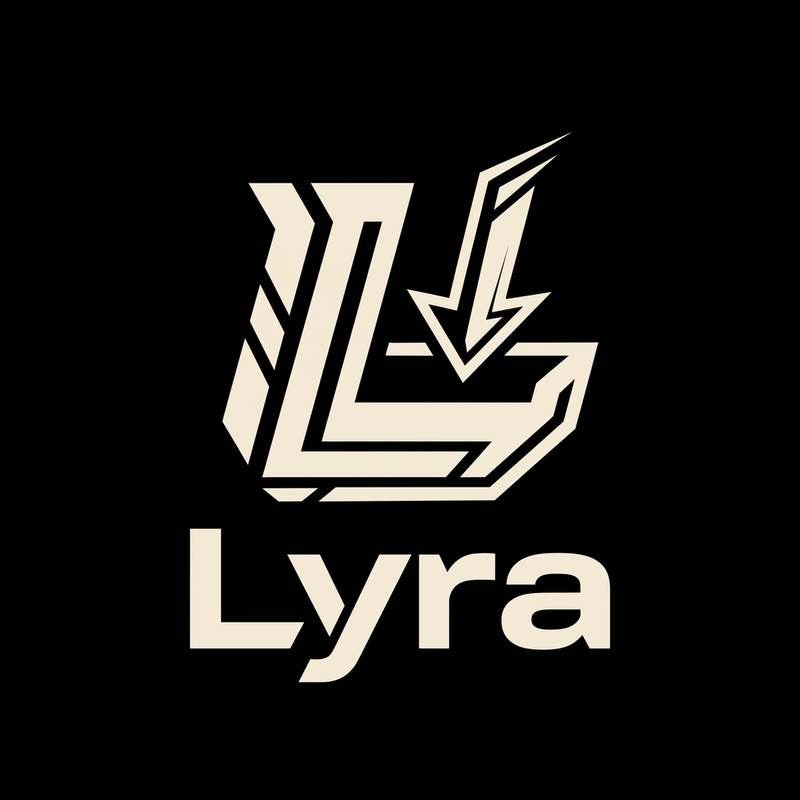
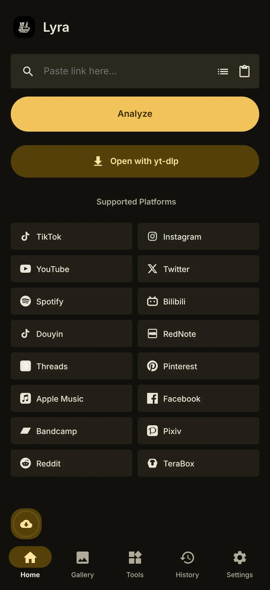
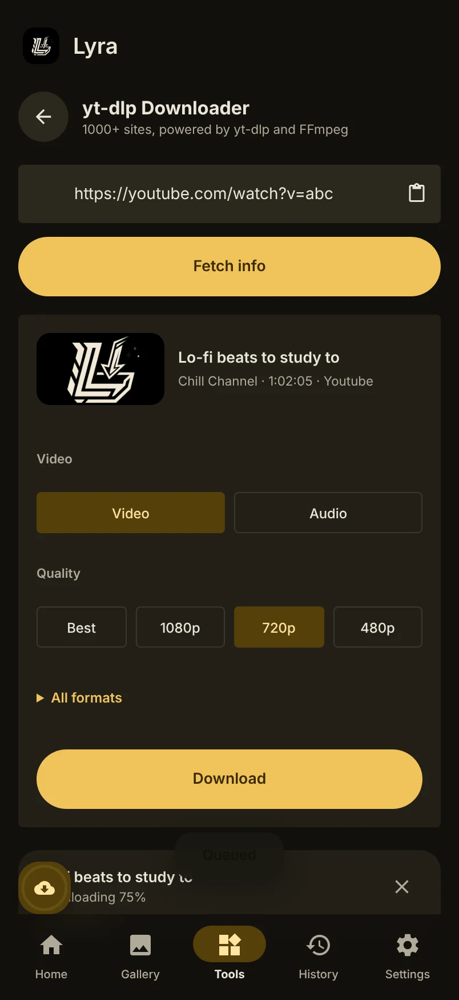
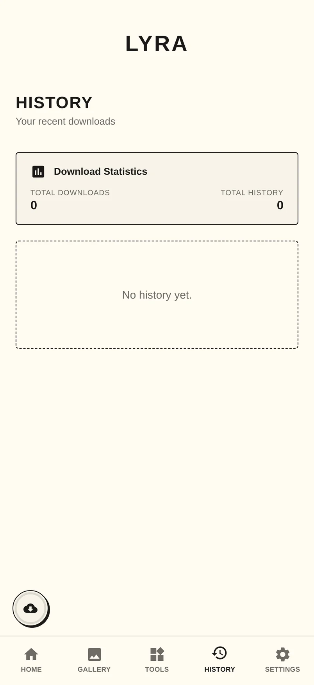
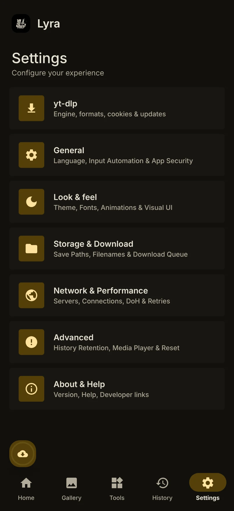
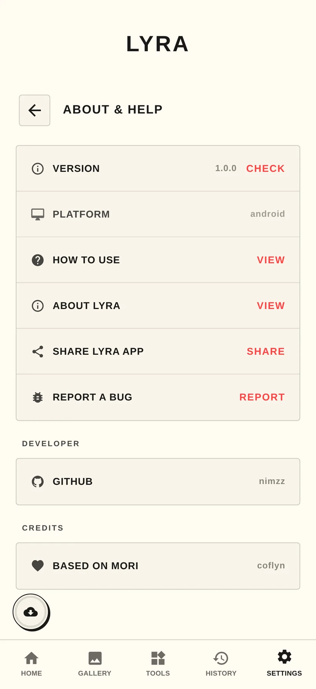
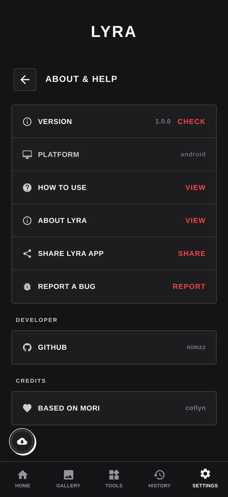

<p align="center">
  
</p>

<p align="center"><em>Save anything, from anywhere.</em></p>

<p align="center">
  
  
  
  
  
  
</p>

<div align="center">

Save videos, photos, and audio from 16 platforms with built-in media tools. No watermarks, accounts, or tracking. Everything runs locally on your device.

</div>

## Screenshots

<p align="center">
  
  
  
</p>
<p align="center">
  
  
  
</p>

---

## Table of contents

1. [How to use](#how-to-use)
2. [Download and installation](#download-and-installation)
3. [Platform support](#platform-support)
4. [Features](#features)
5. [Built-in tools suite](#built-in-tools-suite)
6. [Supported platforms & scraper engines](#supported-platforms--scraper-engines)
7. [For developers & building from source](#for-developers--building-from-source)
8. [Scraper architecture](#scraper-architecture)
9. [Credits](#credits)
10. [Disclaimer](#disclaimer)
11. [License](#license)

---

## How to use

Download media in three steps:

1. Copy a video, photo, or music link from any supported app.
2. Open Lyra. The app reads the clipboard automatically. On Android, you can also tap Share on any post and select Lyra.
3. Choose your quality or format and tap Download. Files are saved straight to your device.

## Download and installation

Pre-compiled packages are published on [GitHub Releases](https://github.com/NimzzAI/Lyra/releases).

| Platform | Package | Guide |
| :--- | :--- | :--- |
|  Android 7.0+ (including Android 10) | `Lyra-v...-arm64-v8a.apk` (most phones)<br>`Lyra-v...-armeabi-v7a.apk`<br>`Lyra-v...-x86_64.apk`<br>`Lyra-v...-universal.apk` | [Android installation](GUIDE.md#android-installation--troubleshooting) |
|  iOS | `Lyra-v...-iOS-Unsigned.ipa` | [iOS sideloading](GUIDE.md#ios-sideloading-guide) |
|  Windows 10 / 11 | `Lyra-v...-Windows-x64-Setup.exe`<br>`Lyra-v...-Windows-x64-Portable.exe` | [Desktop guide](GUIDE.md#desktop-windows-linux-macos) |
|  Linux | `Lyra-v...-Linux-x64.AppImage`<br>`Lyra-v...-Linux-x64.deb` | [Desktop guide](GUIDE.md#desktop-windows-linux-macos) |
|  macOS (Intel and Apple Silicon) | `Lyra-v...-macOS-*.dmg` | [Desktop guide](GUIDE.md#desktop-windows-linux-macos) |

> For installation steps and troubleshooting, read the [User Guide (GUIDE.md)](GUIDE.md).

---

## Platform support

| Platform | Status | Notes |
| :--- | :--- | :--- |
| Android | Primary target | Android 7.0 (API 24) and newer. Android 10 (API 29) is a supported target and every CI build is launched on an Android 10 emulator. Android 10 devices need an up-to-date **Android System WebView** (Chrome 85 or newer); Lyra shows an update notice when it is too old. |
| iOS | Supported | Capacitor shell with the same UI. Distributed as an unsigned IPA for sideloading. |
| Windows, Linux, macOS | Supported | Electron wrapper in [`desktop/`](desktop). Downloads go to `Downloads/Lyra` and `Music/Lyra` by default, and the folder picker lets you choose any directory. |

Desktop builds are not code-signed. Windows SmartScreen and macOS Gatekeeper may warn on first launch; see the [Desktop guide](GUIDE.md#desktop-windows-linux-macos).

Mobile-only features: Share-sheet Quick Save, background download service, floating download bubble notifications, biometric lock, haptics, and the live Media Sniffer browser. PIN lock and every downloader feature work on desktop.

---

## Features

- Downloads watermark-free videos, photos, and audio from 16 platforms (TikTok, Instagram, YouTube, Twitter/X, Spotify, Apple Music, Pinterest, Facebook, Threads, Bandcamp, Pixiv, Bilibili, Douyin, RedNote, Reddit, TeraBox).
- **yt-dlp engine (Android)** powered by Seal's youtubedl-android: 1200+ sites, format picker, playlists, MP3/M4A/Opus extraction, subtitles, SponsorBlock, cookies, and in-app yt-dlp updates.
- Built-in media tools including a browser stream sniffer, offline audio extractor, image converter, PDF compressor, username availability checker, and anime scene search.
- In-app APK updates directly through GitHub Releases with localized changelogs.
- Customizable filename templates using `{platform}`, `{date}`, `{time}`, `{quality}`, `{num}`, and `{title}`, with persistent sequential counters per platform.
- Real-time download progress with byte counters, transfer speed, stall detection, and storage write status.
- Automatic MediaStore indexing on Android so new files show up immediately in gallery and music apps.
- Custom download folders, including external SD cards on Android and any folder on desktop.
- Full album and playlist downloads for Spotify, Apple Music, and YouTube.
- Parallel downloads with up to 5 concurrent workers for albums and photo carousels.
- Floating download bubble with an aggregated progress ring, task drawer, and cancellation controls.
- Android Share menu integration to download media without opening the main app.
- Batch downloader to queue multiple links at once.
- Built-in media player with timeline scrubbing, double-tap seek, and audio controls.
- Local media gallery to browse and filter saved videos, music, photos, and PDFs.
- Photo carousel to PDF export for offline reading.
- Optional PIN lock (plus biometric lock on mobile) for history and settings.
- Background downloads with wake-lock support on Android.
- Available in 9 languages (English, Indonesian, Japanese, Korean, Simplified Chinese, Arabic with RTL layout, Russian, Tagalog, Hindi).
- Runs entirely on-device with no accounts, ads, or tracking.

---

## Built-in tools suite

The Tools tab provides client-side utilities that run locally on your device:

| Tool | Type | Description |
| :--- | :--- | :--- |
| Media Sniffer | Network Sniffer | Live in-app browser that intercepts video, audio, and HLS (.m3u8) streams while blocking ads and trackers. Mobile only. |
| Video to Audio Extractor | Offline Utility | Decodes local video files (MP4, MKV, WebM, MOV) into WAV or MP3 audio using the Web Audio API. |
| Image Converter & Scaler | Offline Utility | Converts and resizes images between WebP, JPG, and PNG with adjustable quality and resolution scaling. |
| PDF Document Compressor | Offline Utility | Compresses PDF files locally using bundled pdf-lib and pdf.js, with three compression presets. |
| Username Checker | Lookup | Checks username availability across 20+ social platforms simultaneously. |
| Anime Scene Search | Lookup | Reverse searches anime screenshots using trace.moe to find anime titles, episode numbers, and timestamps. |
| TikTok Profile Lookup | Lookup | Displays public profile information, stats, follower counts, and avatars. |
| Shortlink Resolver | URL Resolver | Resolves target URLs from supported ad gateways and shorteners. |

---

## Supported platforms & scraper engines

| Platform | Supported Domains / Formats | Features | Scraper Engine / Provider |
| :

---

## For developers & building from source

To set up the development environment, contribute translations, or build locally:

- Read [CONTRIBUTING.md](CONTRIBUTING.md) for build requirements and compilation instructions for Android, iOS, and desktop.
- Read [CHANGELOG.md](CHANGELOG.md) for release history.

<details>
<summary><b>Tech Stack & Project Structure</b></summary>

### Built With

- **JavaScript (ES6+)**: Core application logic and client-side UI.
- **HTML5 & CSS3**: Responsive design system with dark mode.
- **CapacitorJS**: Native Android and iOS bridge for filesystem, share sheet, clipboard, and biometrics.
- **Electron**: Desktop shell for Windows, Linux, and macOS. A small compatibility layer exposes the same plugin interface the app uses on mobile, backed by Node.js for networking and file access.
- **OkHttp (Native Android)**: HTTP client for WebView CORS handling.
- **pdf-lib**: Client-side PDF generation.

### Project Structure

```
Lyra/
├── android/                    # Capacitor Android native project (com.nimzz.lyra)
│   ├── app/src/main/
│   │   ├── java/com/nimzz/lyra/
│   │   │   ├── DownloadForegroundService.java # Background download persistent service & wake-lock
│   │   │   ├── MainActivity.java   # Main Activity + native HTTP bridge & frame extractor
│   │   │   └── ShareActivity.java  # Native Quick Save Share overlay & MediaStore indexer
│   │   └── res/                # Android layout, drawables, XML configs & splash screens
│   └── gradle/                 # Gradle build scripts & configurations
├── ios/                        # Capacitor iOS Xcode workspace
│   └── App/                    # iOS Xcode project, Info.plist, and CocoaPods
├── desktop/                    # Electron app for Windows, Linux and macOS
│   ├── main.js                 # Main process: window, lyra:// protocol, IPC, self-check mode
│   ├── preload.js              # Context-isolated bridge exposed as window.lyraDesktop
│   ├── lib/
│   │   ├── fsops.js            # Filesystem operations behind the Capacitor Filesystem API
│   │   ├── http.js             # Node HTTP client (redirects, gzip/br, cookies) and file downloads
│   │   └── paths.js            # Android-style relative paths mapped to OS folders
│   ├── build/                  # App icons (ico, icns, png)
│   └── package.json            # electron-builder configuration
├── assets/                     # Logo, app icon, and screenshots
├── public/                     # Frontend assets (Vanilla JS + CSS)
│   ├── css/                    # Modular CSS architecture
│   ├── js/
│   │   ├── app.js              # Application entry point and startup lifecycle
│   │   ├── components/         # Reusable UI components (player)
│   │   ├── downloader/         # Modular native download engine
│   │   ├── i18n/               # Multi-language translations (9 languages + RTL support)
│   │   ├── modules/            # Core business logic & application state
│   │   │   ├── settings/       # Settings subsystems (appearance, storage, language)
│   │   │   ├── tools/          # Built-in offline & online utilities
│   │   │   └── update.js       # GitHub release checker & in-app updater
│   │   ├── platform/
│   │   │   └── desktop.js      # Capacitor-compatible plugin layer used by the desktop app
│   │   ├── scrapers/           # Scraper runtime loader, HTTP helper and precompiled bundle
│   │   ├── ui/                 # UI presentation layer
│   │   ├── utils/              # Helper utilities
│   │   └── vendor/             # Third-party libraries (pdf-lib, pdf.js)
│   ├── index.html              # Main application markup
│   └── share.html              # Android Quick Save Share Overlay markup
├── .github/
│   ├── workflows/              # CI: Android (with Android 10 smoke test), iOS, desktop
│   └── scripts/                # CI helper scripts
├── capacitor.config.json       # Capacitor configuration
├── package.json                # Project dependencies and build scripts
├── CHANGELOG.md                # Version release history
├── CONTRIBUTING.md             # Developer setup and contribution guidelines
├── GUIDE.md                    # User manual
├── LICENSE                     # GNU General Public License v3.0
└── README.md                   # Project documentation
```

</details>

---

## Scraper architecture

Scrapers are shipped as a single precompiled bundle at `public/js/scrapers/bundle.js` containing all 16 platform engines.

- The bundle is carried over from the upstream Mori project and ships with regular app updates through GitHub Releases.
- The UI, native bridges, desktop layer, and scraper wrappers are open source under GPL-3.0.
- Platform scraper fixes and updates can be submitted by following [CONTRIBUTING.md](CONTRIBUTING.md).

---

## Credits

Lyra is based on **[Mori](https://github.com/coflyn/Mori)** by **[coflyn](https://github.com/coflyn)**. Thank you for the excellent foundation, and for releasing it under GPL-3.0 so projects like this one can build on it. Please consider starring the original repository.

Lyra is developed and maintained by **[Nimzz](https://github.com/NimzzAI)**.

---

## Disclaimer

- Personal and educational use only: Lyra is intended for personal media archiving and research. Users are responsible for complying with local copyright laws and the terms of service of each platform.
- No media hosting: Lyra does not host, cache, or redistribute media files on external servers. All downloads execute directly on the user's device.
- Upstream services: Lyra queries public web endpoints. If you operate an upstream service and want an endpoint removed, open a [GitHub issue](https://github.com/NimzzAI/Lyra/issues).

---

## License

Lyra is licensed under the [GNU General Public License v3.0 (GPL-3.0)](LICENSE).

- Anyone modifying or redistributing this software must release the complete corresponding source code under GPL-3.0.
- Commercial redistribution or distributing closed-source builds of Lyra without adhering to GPL-3.0 is not permitted.
- Lyra is a derivative work of Mori. The Mori name and logo belong to its original author; Lyra uses its own name and artwork. Original copyright notices are preserved in the source files and in [CHANGELOG.md](CHANGELOG.md).

---

Developed by Nimzz.  
GitHub: https://github.com/NimzzAI  
Based on Mori by coflyn: https://github.com/coflyn/Mori


---

## Also thanks to

- [Seal](https://github.com/JunkFood02/Seal) by JunkFood02 for the yt-dlp Android integration approach and library.
- [yt-dlp](https://github.com/yt-dlp/yt-dlp) and [youtubedl-android](https://github.com/yausername/youtubedl-android).
- [Metrolist](https://github.com/MetrolistGroup/Metrolist) and [ArchiveTune](https://github.com/koiverse/ArchiveTune) for design inspiration.
